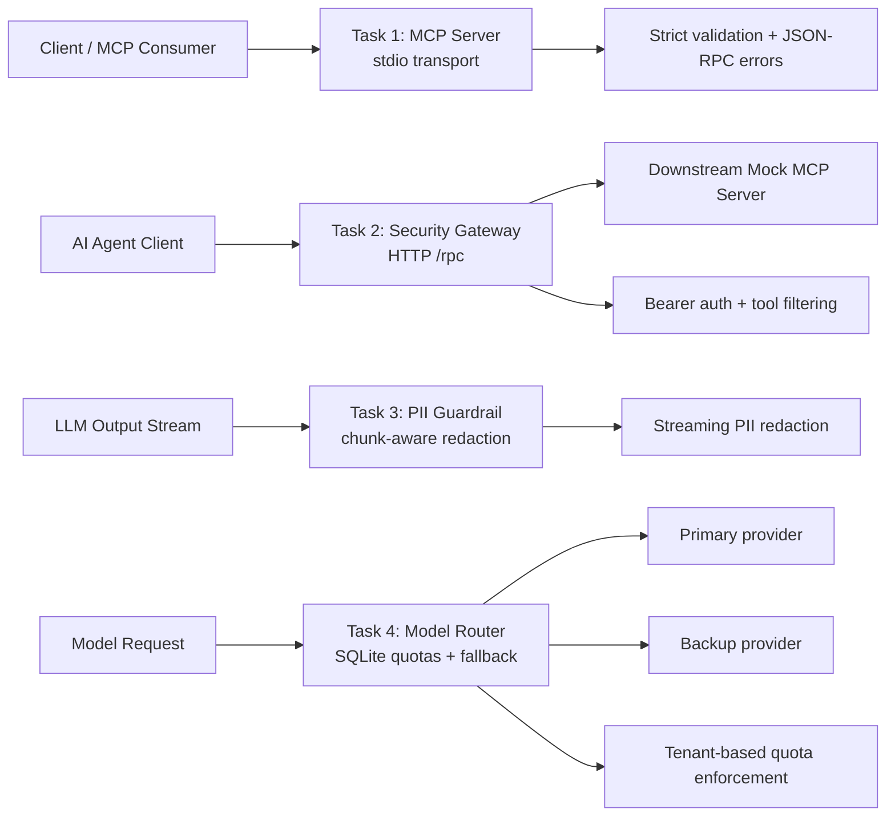
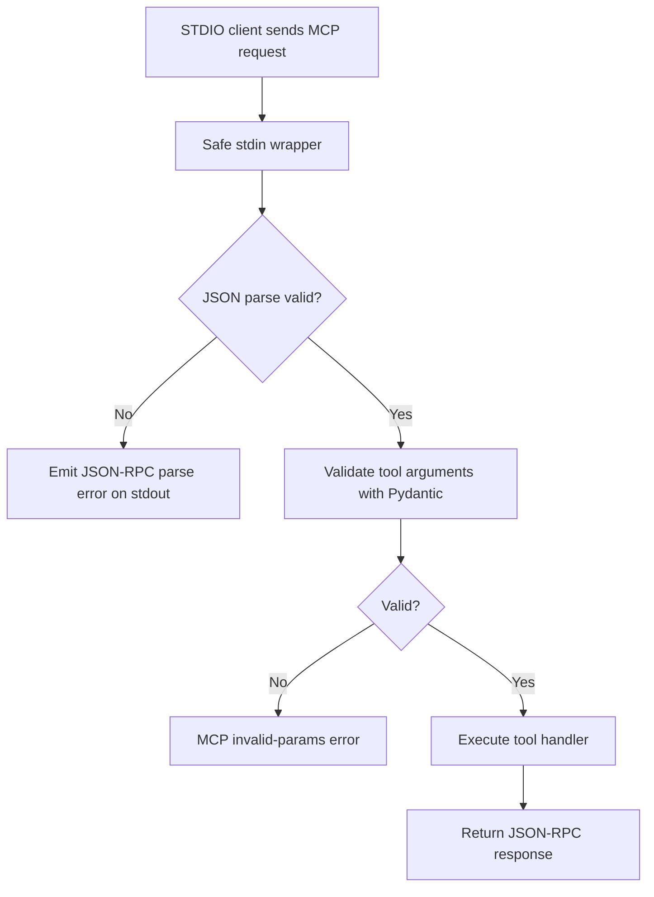
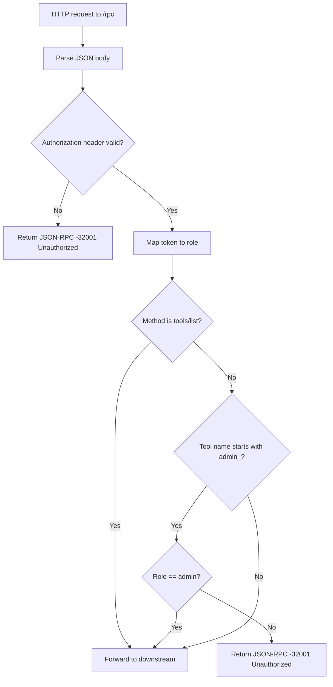
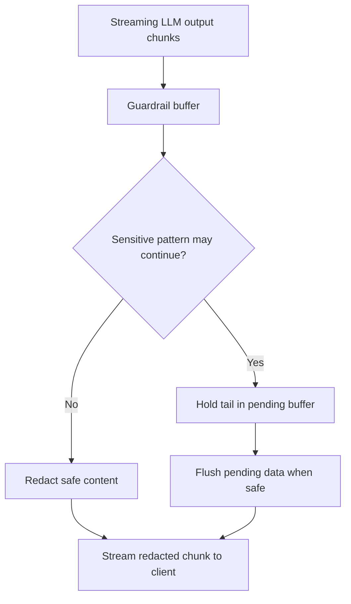
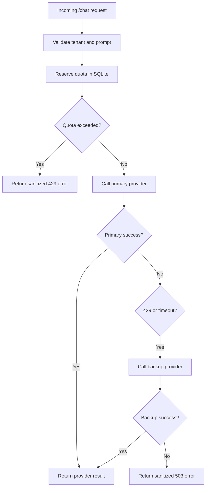

# LLM MCP Gateway Assessment

Task1: a strict MCP customer server, Task 2: a security gateway,Task 3: a streaming PII redaction guardrail, Task 4: rate-limited model router with fallback behavior.

 Each task is implemented independently under `src/` and validated by its test file in `tests/`. 

## Table of Contents

- [Project Overview](#project-overview)
- [Architecture Overview](#architecture-overview)
- [Task 1 — Custom MCP Server](#task-1--custom-mcp-server)
- [Task 2 — MCP Security Gateway](#task-2--mcp-security-gateway)
- [Task 3 — Streaming PII Guardrail](#task-3--streaming-pii-guardrail)
- [Task 4 — Rate Limiting and Model Fallback](#task-4--rate-limiting-and-model-fallback)
- [Project Directory Structure](#project-directory-structure)
- [Prerequisites and Installation](#prerequisites-and-installation)
- [Running the Four Tasks](#running-the-four-tasks)
- [Testing](#testing)
- [Requirements Traceability Matrix](#requirements-traceability-matrix)
- [Design Decisions and Limitations](#design-decisions-and-limitations)
- [Conclusion](#conclusion)

## Project Overview


1. building a strict MCP server over stdio,
2. enforcing role-based authorization in a gateway,
3. redacting sensitive data in streamed model output,
4. protecting an LLM gateway with quotas and failover logic.

### Summary table

| Task | Focus | Key Libraries | Verified status |
| --- | --- | --- | --- |
| 1 | MCP server and tool validation | `mcp`, `pydantic`, `anyio` | Implemented and tested |
| 2 | JSON-RPC security gateway | `fastapi`, `httpx` | Implemented and tested |
| 3 | Streaming PII redaction | `fastapi`, regex processing | Implemented and tested |
| 4 | Rate limiting and fallback routing | `aiosqlite`, `sqlite3`, `fastapi`, `httpx` | Implemented and tested |

### Technologies used

- Python 3.12
- `mcp` official SDK
- `pydantic` v2 validation
- `fastapi` for HTTP gateway and streaming endpoints
- `httpx` for outbound requests
- `aiosqlite` and SQLite for persistence
- `pytest` and `pytest-asyncio` for automated validation

---

## Architecture Overview

These four tasks are independent modules under `src/`. They are not one integrated application; they represent different layers in an LLM/MCP architecture.



### Important architectural note

The code is intentionally modular to match the assessment: each task focuses on one responsibility and is validated separately.

---

## Task 1 — Custom MCP Server

### Original requirement summary

Build a runnable MCP server in Python using the official MCP SDK exposing two tools:

- `get_customer_record`
- `trigger_refund`

Requirements:

- validate `customer_id` as `CUST-XXXXX`,
- validate a positive `amount` and a reason with minimum length 10,
- reject invalid requests with standard MCP JSON-RPC errors,
- use stdio transport,
- reserve stdout for JSON-RPC protocol messages only,
- send logs to stderr.

### Objective and real-world use case

This is a minimal but realistic MCP tool server for customer operations. It demonstrates how to validate tool input strictly before performing mock business actions.

### MCP and JSON-RPC context

The implementation uses the official `mcp` Python SDK and `mcp.server.lowlevel.Server` to register tools and return MCP/JSON-RPC 2.0 responses over stdio.

### Implemented tools

#### 1) `get_customer_record`

Input shape:

```json
{
  "customer_id": "CUST-AB12C"
}
```

Validation rules:

- `customer_id` must be a string,
- must match `^CUST-[A-Z0-9]{5}$`.

#### 2) `trigger_refund`

Input shape:

```json
{
  "customer_id": "CUST-AB12C",
  "amount": 49.99,
  "reason": "Duplicate charge on the monthly plan."
}
```

Validation rules:

- `customer_id` must match the same strict format,
- `amount` must be a positive finite float,
- `reason` must be a string with at least 10 characters.

### Actual implementation details

Main implementation file:

- `src/task1_mcp_server/server.py`

Key elements:

- `CustomerRecordArgs` and `RefundArgs` built with `pydantic.BaseModel` + `ConfigDict(strict=True)`
- `CUSTOMER_ID_PATTERN` enforcing the exact `CUST-XXXXX` format
- `_validate_tool_arguments` converting invalid payloads to MCP errors
- `_list_tools` exposing both tools with schema metadata
- `_get_customer_record` and `_trigger_refund` returning structured content and text payloads
- `_SafeStdioInput` and `_SafeStdioOutput` wrapping stdio streams
- `main()` launching the MCP server over stdio

### STDIO isolation and stderr logging

The server keeps stdout reserved for JSON-RPC protocol output. Malformed input is converted into a JSON-RPC parse error message written to stdout by the safe wrapper, while the logic intentionally avoids noisy debugging output on stdout.

### Error handling and JSON-RPC mapping

The server raises `MCPError` for invalid parameters or unknown tools, which maps to standard MCP/JSON-RPC error responses. Malformed JSON input is converted into a parse error payload instead of crashing the process.

### Mermaid flow



### Valid and invalid request examples

Valid request:

```json
{
  "jsonrpc": "2.0",
  "id": 1,
  "method": "tools/call",
  "params": {
    "name": "get_customer_record",
    "arguments": {
      "customer_id": "CUST-AB12C"
    }
  }
}
```

Invalid request:

```json
{
  "jsonrpc": "2.0",
  "id": 2,
  "method": "tools/call",
  "params": {
    "name": "trigger_refund",
    "arguments": {
      "customer_id": "INVALID",
      "amount": -5,
      "reason": "bad"
    }
  }
}
```

### File location

- `src/task1_mcp_server/server.py`
- `tests/test_task1.py`

### Run and test Task 1

Start the server over stdio:

```bash
cd /path/to/llm_mcp_gateway_python
source .venv/bin/activate
PYTHONPATH=src python -c "import asyncio; from task1_mcp_server.server import main; asyncio.run(main())"
```

Run the file-specific tests:

```bash
PYTHONPATH=src python -m pytest tests/test_task1.py -q
```

### Limitations and requirement gaps

- This is a mock customer backend, not a production customer system.
- It is intentionally minimal and assessment-focused.
- No persistent database or external identity layer is included.

---

## Task 2 — MCP Security Gateway

### Original requirement summary

Build a lightweight HTTP/JSON-RPC reverse proxy between an AI agent client and a downstream mock MCP server.

Requirements:

- parse `Authorization: Bearer <token>`,
- map the role (for example `admin` or `viewer`),
- forward `tools/list` transparently,
- for `tools/call`, inspect `params.name`,
- block `admin_` tool names unless the caller is `admin`,
- return JSON-RPC error `-32001` with message `Unauthorized Tool Call`,
- do not forward unauthorized calls downstream.

### Objective and real-world use case

This is a gateway layer that enforces tool-level authorization before downstream MCP tool execution. It is relevant to AI agent systems where different users or roles should not access all tool capabilities.

### Implementation details

Main files:

- `src/task2_security_gateway/gateway.py`
- `src/task2_security_gateway/downstream.py`

The gateway maps tokens to roles:

```python
ROLE_TOKENS = {
    "demo-admin-token": "admin",
    "demo-viewer-token": "viewer",
}
```

The downstream app exposes:

- `tools/list`
- `tools/call`
- sample tools `echo_message` and `admin_reset_cache`

### Authorization logic

At `/rpc`, the code checks:

- request body is valid JSON,
- payload is a dict,
- `Authorization` header exists and starts with `Bearer `,
- token is recognized,
- `tools/list` is forwarded for valid roles,
- `tools/call` with names starting with `admin_` requires `admin`,
- unauthorized requests return the correct error structure.

### HTTP forwarding behavior

The gateway uses `httpx.AsyncClient` to proxy valid requests to the downstream app. The downstream URL is normalized before the request is sent.

### Mermaid authorization flow



### Authorized and unauthorized examples

Authorized list request:

```bash
curl -X POST http://127.0.0.1:8000/rpc \
  -H 'Authorization: Bearer demo-viewer-token' \
  -H 'Content-Type: application/json' \
  -d '{"jsonrpc":"2.0","id":42,"method":"tools/list","params":{}}'
```

Unauthorized admin tool request:

```bash
curl -X POST http://127.0.0.1:8000/rpc \
  -H 'Authorization: Bearer demo-viewer-token' \
  -H 'Content-Type: application/json' \
  -d '{"jsonrpc":"2.0","id":7,"method":"tools/call","params":{"name":"admin_reset_cache","arguments":{"scope":"all"}}}'
```

Expected result:

```json
{
  "jsonrpc": "2.0",
  "id": 7,
  "error": {
    "code": -32001,
    "message": "Unauthorized Tool Call"
  }
}
```

### File locations

- `src/task2_security_gateway/gateway.py`
- `src/task2_security_gateway/downstream.py`
- `tests/test_task2.py`

### Run and test Task 2

Start the gateway app via Uvicorn:

```bash
cd /path/to/llm_mcp_gateway_python
source .venv/bin/activate
PYTHONPATH=src uvicorn task2_security_gateway.gateway:create_gateway_app --factory --host 127.0.0.1 --port 8000
```

Run the task tests:

```bash
PYTHONPATH=src python -m pytest tests/test_task2.py -q
```

### Limitations and requirement gaps

- This is a demo gateway, not a full OAuth/JWT identity provider.
- The authorization model is static and token-based.
- It is assessment-focused and intentionally minimal rather than production-ready security infrastructure.

---

## Task 3 — Streaming PII Guardrail

### Original requirement summary

Build an LLM gateway proxy endpoint that:

- streams generation output back to the client,
- intercepts chunks in real time,
- detects sensitive values such as email addresses, SSNs, and credit-card numbers,
- redacts them as `[REDACTED]`,
- handles patterns split across chunk boundaries,
- avoids buffering the entire response,
- keeps latency low.

### Objective and real-world use case

This protects model output in streaming scenarios where sensitive information may appear mid-stream. It is relevant when AI output is displayed to users or persisted downstream in real time.

### Supported sensitive-data patterns

The implementation redacts:

- email addresses,
- SSNs in the form `123-45-6789`,
- credit cards with a 15–19 digit pattern.

The detection is implemented in:

- `src/task3_pii_guardrail/guardrail.py`

### How the implementation works

The core logic is:

1. `StreamingPiiGuardrail.process_chunk()` buffers a small trailing segment,
2. `redact_stream()` yields redacted output while preserving memory bounds,
3. `mock_llm_stream()` simulates a streaming response.

The guardrail keeps a tail buffer of recent characters and only flushes safe content when it is confident the text can no longer become part of a sensitive pattern.

### Buffering strategy and memory considerations

The class is designed to limit buffering to a bounded `max_lookbehind` window instead of holding an entire response. This helps keep memory usage low in a streaming pipeline.

### TTFT and latency tradeoffs

The implementation is intentionally lightweight and keeps per-chunk processing minimal. It does not buffer the entire response, which helps keep time-to-first-token and streaming latency reasonable.

### Mermaid streaming flow



### Example input chunks and redacted outputs

Input chunks:

```text
Chunk 1: "Contact alic"
Chunk 2: "e@example.com and SSN 123-"
Chunk 3: "45-6789; card 4111 1111 1111 "
Chunk 4: "1111."
```

Output after redaction:

```text
Contact [REDACTED] and SSN [REDACTED]; card [REDACTED].
```

### File locations

- `src/task3_pii_guardrail/guardrail.py`
- `tests/test_task3.py`

### Run and test Task 3

Start the guardrail app with Uvicorn:

```bash
cd /path/to/llm_mcp_gateway_python
source .venv/bin/activate
PYTHONPATH=src uvicorn task3_pii_guardrail.guardrail:create_guardrail_app --factory --host 127.0.0.1 --port 8001
```

The app exposes:

- `GET /health`
- `GET /stream`

Run the task tests:

```bash
PYTHONPATH=src python -m pytest tests/test_task3.py -q
```

### Known regex and streaming limitations

- This is regex-based detection, not a general-purpose sensitive-data classifier.
- It covers the relevant patterns in the prompt but not every possible PII category.
- It does not integrate with a real LLM provider or live upstream streaming API.
- It is a demo-grade guardrail rather than a production privacy filter.

---

## Task 4 — Rate Limiting and Model Fallback

### Original requirement summary

Build a resilient model-routing module that accepts incoming completion requests and enforces token-aware quota rules. The implementation must:

- use SQLite persistence,
- persist per-tenant counts,
- manage a sliding-window token quota,
- fail over to a backup model when the primary is rate-limited or times out,
- return sanitized errors.

### Objective and real-world use case

This task demonstrates how a gateway can protect upstream providers against overload and provide continuity when a primary model provider is unavailable or slow.

### Token-aware rate limiting

The implementation is in:

- `src/task4_model_router/router.py`

The actual limiter uses SQLite with a `usage` table and per-tenant records keyed by tenant plus a bucket start timestamp. This is a simplified assessment implementation of a rolling window quota system.

### SQLite usage and persistence

The code creates a `usage` table on the filesystem and deletes stale rows before checking the current quota. This satisfies the on-disk SQLite requirement of the task.

### Per-tenant tracking and window expiration

The `TenantRateLimiter` class stores per-tenant usage and removes stale entries older than a 60-second window from the active usage calculation.

### Primary and backup selection

The router:

- accepts a request payload with `tenant` and `prompt`,
- calls `MockProvider("primary", ...)`,
- if the call raises a timeout or HTTP status error, it tries a backup provider,
- returns a JSON response with the selected provider name and result payload.

### HTTP 429 fallback behavior

`MockProvider.call()` checks `response.status_code == 429` and raises `httpx.HTTPStatusError`. The router catches this path and attempts the backup provider.

### Timeout behavior

The router catches `httpx.TimeoutException` and attempts failover. However, the actual configured timeout in the mock provider is `0.5` seconds, not a literal 3000ms threshold from the original requirement.

### Standardized error responses

Rate-limit and provider errors are sanitized via helper functions that return JSON responses without exposing internal exceptions or stack traces.

### Mermaid model-routing flow



### Example request and responses

Successful request:

```bash
curl -X POST http://127.0.0.1:8002/chat \
  -H 'Content-Type: application/json' \
  -d '{"tenant":"tenant-a","prompt":"Summarize the release notes."}'
```

Example success response:

```json
{
  "provider": "primary",
  "result": {
    "answer": "..."
  }
}
```

Quota violation response:

```json
{
  "jsonrpc": "2.0",
  "error": {
    "code": "rate_limited",
    "message": "Rate limit exceeded"
  }
}
```

Timeout fallback example:

```json
{
  "provider": "backup",
  "result": {
    "answer": "ok from backup"
  }
}
```

### File locations

- `src/task4_model_router/router.py`
- `tests/test_task4.py`

### Run and test Task 4

Start the router app with Uvicorn:

```bash
cd /path/to/llm_mcp_gateway_python
source .venv/bin/activate
PYTHONPATH=src uvicorn task4_model_router.router:create_router_app --factory --host 127.0.0.1 --port 8002
```

Run the task tests:

```bash
PYTHONPATH=src python -m pytest tests/test_task4.py -q
```

### Concurrency assumptions and limitations

- This router demonstrates quota enforcement and failover logic in an assessment context.
- It is not a distributed rate limiter using Redis or a central coordination system.
- The timeout behavior is a short client-side timeout and does not exactly enforce a literal 3000ms upstream threshold.

---

## Project Directory Structure

```text
llm_mcp_gateway_python/
├── README.md
├── pytest.ini
├── requirements.txt
├── src/
│   ├── task1_mcp_server/
│   │   ├── __init__.py
│   │   └── server.py
│   ├── task2_security_gateway/
│   │   ├── __init__.py
│   │   ├── downstream.py
│   │   └── gateway.py
│   ├── task3_pii_guardrail/
│   │   ├── __init__.py
│   │   └── guardrail.py
│   └── task4_model_router/
│       ├── __init__.py
│       └── router.py
├── tests/
│   ├── test_task1.py
│   ├── test_task2.py
│   ├── test_task3.py
│   └── test_task4.py
└── .venv/
```

### Key files

- `pytest.ini` adds `src` to the Python path.
- `requirements.txt` documents the dependency set used in this repository.
- `src/taskX_...` packages contain the assessment implementations.
- `tests/` contains the validation suite used for this project.

---

## Prerequisites and Installation

### Requirements

- Python 3.12
- a local virtual environment
- `pip` and standard Python tooling
- optional `uvicorn` for launching the FastAPI app factories manually

### Fresh setup from a clone

```bash
cd /path/to/llm_mcp_gateway_python
python3.12 -m venv .venv
source .venv/bin/activate
python -m pip install --upgrade pip
python -m pip install -r requirements.txt
```

### Configuration note

The repo includes `pytest.ini` with:

```ini
[pytest]
pythonpath = src
```

This ensures imports like `task1_mcp_server.server` resolve consistently during tests.

---

## Running the Four Tasks

### Task 1 — MCP stdio server

```bash
cd /path/to/llm_mcp_gateway_python
source .venv/bin/activate
PYTHONPATH=src python -c "import asyncio; from task1_mcp_server.server import main; asyncio.run(main())"
```

This starts the MCP server over stdio and listens for MCP JSON-RPC requests.

### Task 2 — security gateway

```bash
cd /path/to/llm_mcp_gateway_python
source .venv/bin/activate
PYTHONPATH=src uvicorn task2_security_gateway.gateway:create_gateway_app --factory --host 127.0.0.1 --port 8000
```

Then post to `http://127.0.0.1:8000/rpc` with an `Authorization: Bearer ...` token.

### Task 3 — PII guardrail

```bash
cd /path/to/llm_mcp_gateway_python
source .venv/bin/activate
PYTHONPATH=src uvicorn task3_pii_guardrail.guardrail:create_guardrail_app --factory --host 127.0.0.1 --port 8001
```

Endpoints:

- `GET /health`
- `GET /stream`

### Task 4 — model router

```bash
cd /path/to/llm_mcp_gateway_python
source .venv/bin/activate
PYTHONPATH=src uvicorn task4_model_router.router:create_router_app --factory --host 127.0.0.1 --port 8002
```

Endpoint:

- `POST /chat`

---

## Testing

### Run the full suite

```bash
cd /path/to/llm_mcp_gateway_python
source .venv/bin/activate
python -m pytest -q
```

### Run each task independently

```bash
PYTHONPATH=src python -m pytest tests/test_task1.py -q
PYTHONPATH=src python -m pytest tests/test_task2.py -q
PYTHONPATH=src python -m pytest tests/test_task3.py -q
PYTHONPATH=src python -m pytest tests/test_task4.py -q
```

### What each test file validates

| Test file | Validates |
| --- | --- |
| `tests/test_task1.py` | tool registration, valid tool calls, invalid parameters, malformed JSON-RPC input, stdio isolation |
| `tests/test_task2.py` | auth header checks, role filtering, downstream forwarding, unauthorized admin calls, timeout propagation |
| `tests/test_task3.py` | regex redaction, chunk-boundary handling, non-PII preservation, bounded memory checks |
| `tests/test_task4.py` | tenant isolation, quota behavior, concurrency assumptions, invalid payload handling, backup-provider fallback |

### Verified results

The current codebase was verified with the repository test suite:

```bash
./.venv/bin/python -m pytest -q
```

Result:

```text
17 passed, 1 warning in 1.99s
```

### Warning note

The single warning is an upstream `httpx` deprecation warning emitted during `tests/test_task2.py`. It does not indicate a failing test or broken project logic.

---

## Requirements Traceability Matrix

| Task | Original Requirement | Implementation File/Function | Test Coverage | Status |
| --- | --- | --- | --- | --- |
| 1 | Build custom MCP server exposing `get_customer_record` and `trigger_refund` | `src/task1_mcp_server/server.py` — `_get_customer_record`, `_trigger_refund`, `main()` | `tests/test_task1.py` | Implemented and Tested |
| 1 | Strict `CUST-XXXXX` validation via Pydantic | `CustomerRecordArgs`, `RefundArgs` | `tests/test_task1.py` | Implemented and Tested |
| 1 | Reject invalid formats with JSON-RPC errors | `_validate_tool_arguments`, `MCPError` usage | `tests/test_task1.py` | Implemented and Tested |
| 1 | Use stdio transport | `stdio_server` in `main()` | `tests/test_task1.py` | Implemented and Tested |
| 1 | Isolate stdout for protocol messages only | `_SafeStdioInput`, `_SafeStdioOutput` | `tests/test_task1.py` | Implemented and Tested |
| 2 | Read `Authorization: Bearer <token>` | gateway request handling | `tests/test_task2.py` | Implemented and Tested |
| 2 | Role extraction (`admin` / `viewer`) | `ROLE_TOKENS` mapping | `tests/test_task2.py` | Implemented and Tested |
| 2 | Forward `tools/list` to downstream | `if method == "tools/list"` | `tests/test_task2.py` | Implemented and Tested |
| 2 | Filter `admin_` tool calls | `tool_name.startswith("admin_")` check | `tests/test_task2.py` | Implemented and Tested |
| 2 | Return JSON-RPC `-32001` unauthorized response | `_jsonrpc_error` with `-32001` | `tests/test_task2.py` | Implemented and Tested |
| 2 | Do not forward unauthorized calls downstream | gateway logic blocks unauthorized tools | `tests/test_task2.py` | Implemented and Tested |
| 3 | Detect email, SSN, and credit-card patterns | regex rules in `guardrail.py` | `tests/test_task3.py` | Implemented and Tested |
| 3 | Replace sensitive values with `[REDACTED]` | `_redact_text()` | `tests/test_task3.py` | Implemented and Tested |
| 3 | Handle chunk-boundary splits | `StreamingPiiGuardrail.process_chunk()` | `tests/test_task3.py` | Implemented and Tested |
| 3 | Avoid full response buffering | bounded `pending` buffer | `tests/test_task3.py` | Implemented and Tested |
| 3 | Real-time streaming interception | `stream_response()` + `mock_llm_stream()` | `tests/test_task3.py` | Partially Implemented |
| 3 | Real provider integration and live upstream streaming | no real provider integration present | not covered | Not Implemented |
| 4 | Token-aware rate limiting and SQLite persistence | `TenantRateLimiter` + SQLite table | `tests/test_task4.py` | Implemented and Tested |
| 4 | Per-tenant sliding-window quota enforcement | `reserve()` with window cleanup | `tests/test_task4.py` | Implemented and Tested |
| 4 | Failover on HTTP 429 | `MockProvider.call()` and router fallback | `tests/test_task4.py` | Implemented and Tested |
| 4 | Failover on timeout | `httpx.TimeoutException` fallback | `tests/test_task4.py` | Implemented and Tested |
| 4 | Return sanitized gateway errors | `_sanitize_error()` | `tests/test_task4.py` | Implemented and Tested |
| 4 | Strict 3000ms timeout compliance | provider timeout is `0.5s` in code | partially covered | Partially Implemented |
| 4 | Production-grade distributed rate limiting | no Redis or clustered coordination | not covered | Not Implemented |

### Requirement verdict

The repository meets the assessment objective and validates the intended behaviors described by the task prompts. It does not claim full production readiness, and the main gaps are in real upstream LLM streaming integration and the exact 3000ms timeout semantics.

---

## Design Decisions and Limitations

### Why this architecture was chosen

Each task is implemented as its own module because the assessment is explicitly organized into four independent problems. This keeps each component easy to test, reason about, and review without forcing a single monolithic application.

### Validation strategy

- `pydantic` is used to enforce strict schema validation where the assignment explicitly requires it.
- Error responses are JSON-RPC aligned and follow the types expected by the prompts.
- HTTP gateways use simple token-role checks and minimal `httpx` calling patterns.
- SQLite usage is a realistic assessment approach for a per-tenant quota system.

### Limitations

1. Task 1 is backed by in-memory customer records, not a persistent customer store.
2. Task 2 is a demo gateway, not a production-ready global auth or OAuth implementation.
3. Task 3 uses regex-based redaction and a simulated stream; it is not a full provider-aware privacy filtering system.
4. Task 4 is a lightweight quota/fallback system, not a distributed or horizontally scaled rate limiter.
5. The timeout behavior is implemented with a short mock client timeout instead of a literal 3000ms threshold.
6. No real upstream LLM provider or live external service is integrated into the repo.

### Assessment-focused vs production-grade

This repository is best understood as a coding assessment artifact rather than a turnkey production deployment. It demonstrates practical patterns in MCP, security, streaming redaction, and resilient routing while intentionally keeping each component lightweight and testable.

---

## Conclusion

This repository demonstrates four essential engineering patterns relevant to AI and MCP systems:

- strict MCP tool validation and stdio transport safety,
- request-level RBAC enforcement at a gateway boundary,
- real-time PII sanitization for streaming output,
- quota enforcement and provider failover for model traffic.

The core behaviors have been validated with the project test suite. The implementation is assessment-appropriate, technically coherent, and easy to review, but it is intentionally limited to the scope of the prompts rather than full production deployment.

---

## Verified test command

```bash
./.venv/bin/python -m pytest -q
```

Current verified result:

```text
17 passed, 1 warning in 1.99s
```
